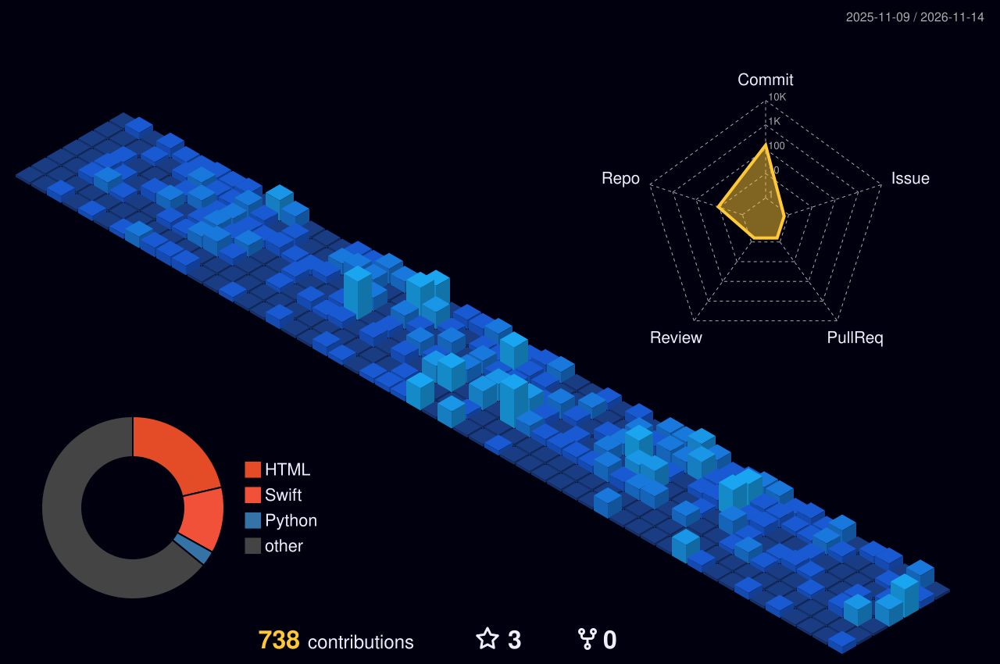

  

# Raaju Pahlowan

 

---

---

---

### `> about`

I'm **Raaju Pahlowan**, an iOS engineer who builds fast, reliable native apps. At **Bdjobs.com** I work on Bangladesh's largest job platform app, including its end-to-end push notification system and authentication networking layer (Alamofire interceptor, token refresh, Keychain).

### `> stack`

Alamofire · REST APIs · MVVM · MVC · Core Data · Keychain · JWT · ARKit · AVFoundation

### `> projects`

<table align="center">
  <tr>
    <td width="50%" valign="top">
      <h4><a href="https://github.com/RaajuPahlowan/Hullor-iOS">Hullor</a></h4>
      Event discovery and ticketing app. Swift, UIKit, Firebase.
    </td>
    <td width="50%" valign="top">
      <h4><a href="https://github.com/RaajuPahlowan/Tactile-Navigator-Glove">Tactile Navigator Glove</a></h4>
      Assistive glove for visually impaired users, with a Bluetooth iOS controller app.
    </td>
  </tr>
  <tr>
    <td width="50%" valign="top">
      <h4><a href="https://github.com/RaajuPahlowan/RetroMovie">RetroMovie</a></h4>
      Movie discovery app with watchlists and trending feeds.
    </td>
    <td width="50%" valign="top">
      <h4><a href="https://github.com/RaajuPahlowan/iOS-Sightseer">Sightseer</a></h4>
      Travel recommendation app built with SwiftUI.
    </td>
  </tr>
</table>

---

&nbsp;

