  

<h1 align="center">
  
</h1>

---

---

---

  Native iOS engineer building fast, reliable apps in Swift, SwiftUI and UIKit. 
  Currently shipping the <b>Bdjobs.com</b> iOS app, Bangladesh's biggest job platform.

  
  &nbsp;
  

&nbsp;

  
  
  
  
  
  

